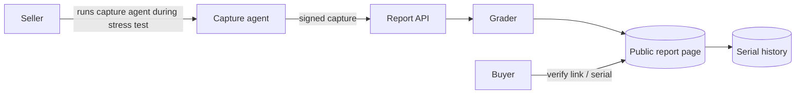

# Architecture — gpuvitals

## 1. Scope
Graded, verifiable health reports for used GPUs from stress-test telemetry.
**MVP:** parse nvidia-smi CSV captures (unit-tolerant), compute load-phase metrics, deduction-based score, grade, fair price, report ID = content hash.
**Product:** signed capture agent, hosted public reports, marketplace badges, serial-number history.

## 2. System context

Note: the capture agent, signed captures, public report pages, and serial history in this
diagram are roadmap items, not shipped — the MVP grades local CSV captures (see §1).

## 3. Grading model
Only **load-phase samples** (utilisation ≥ 90%) are used, so idle samples don't flatter the card.
Deductions: thermal throttling (5 points, plus 3 per °C over the threshold), sustained heat, SM
clock under 90% of max boost, power under 80% of limit, fan maxed while hot, ECC corrected errors
(capped) and uncorrected errors (40 points), pending retired pages, power-on hours over one year,
declared mining. Score = 100 − Σ, graded A to F, with a price multiplier per grade.

## 4. Design decisions
- **Deductions with reasons** instead of an opaque score. Buyers and sellers can see exactly why.
- **Unit-tolerant parser** (`[W]`, `MHz`, `[N/A]`, `Yes/No`). nvidia-smi output varies by driver and card.
- **Report ID = SHA-256 of the raw capture.** Anyone holding the capture can verify the report.
  *Trade-off:* this doesn't prove the capture came from *that* card. The product's capture agent
  signs `{serial, capture, timestamp}` with a key bound to the run and records `nvidia-smi -q` identity fields.

## 5. Future production architecture (not shipped)
A Go capture agent (bundles gpu-burn), a stateless report API, Postgres (reports, serials) and
static report pages on a CDN. A marketplace partner API exposes `GET /reports/{id}` and `GET /serials/{serial}`.
None of this is in this release: the signed capture agent, hosted public report pages, marketplace
badges, and serial history are Roadmap items (see README Roadmap). This release grades local CSV
captures only.

## 6. Risks
Tampered captures (signed agent, plausibility checks across power, clock and temperature
correlations). AMD and Intel GPUs need equivalent parsers (rocm-smi, xpu-smi).
